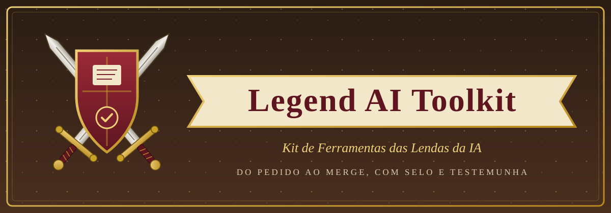
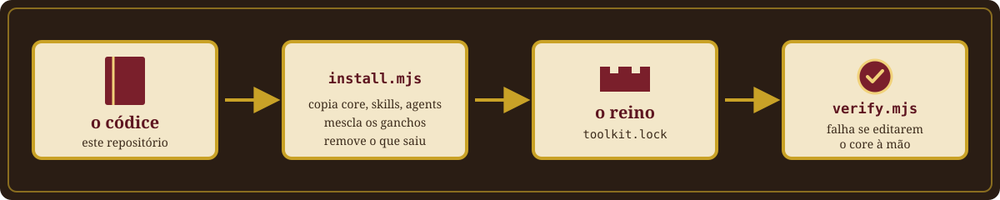
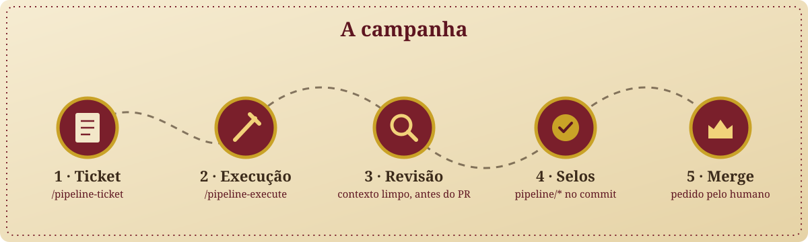
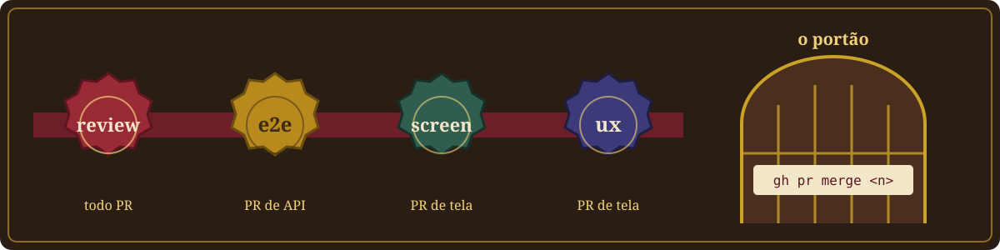
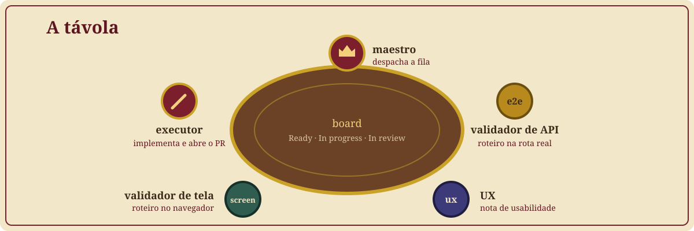

<a id="topo"></a>

<p align="center">
  
</p>

<p align="center">
  <strong>Kit de Ferramentas das Lendas da IA.</strong><br>
  Um pipeline de agentes que leva a demanda do ticket ao merge, com revisão em contexto limpo, selos no commit e merge só quando o humano pede.
</p>

<p align="center">
  <a href="#02--instale-o-códice"><strong>INSTALAR NUM REINO →</strong></a>
  &nbsp;·&nbsp;
  <a href="#07--mude-o-códice"><strong>ATUALIZAR O CÓDICE</strong></a>
  &nbsp;·&nbsp;
  <a href="#03--a-campanha"><strong>CONHECER AS ORDENS</strong></a>
</p>

<p align="center">
  <a href="LICENSE"></a>
  
  
  
</p>

---

Toda lenda começa com um códice. Este é o nosso: as regras, as ordens e os ritos que um time de agentes de IA segue para transformar um pedido em código mergeado, sem atalho e sem esquecer etapa. O códice é um só, e cada reino (cada projeto) o copia inteiro, acrescentando apenas as suas próprias leis.

Na prática, este repositório é a **fonte única** de um pipeline para o Claude Code (e agentes compatíveis): o core com o contrato e o gate de selos, as skills `pipeline-*`, os subagentes e o instalador que leva tudo para o seu projeto.

## 00 / Escolha sua jornada

| Você quer... | Vá para |
| --- | --- |
| Levar o pipeline para um projeto que ainda não o tem | [02 / Instale o códice](#02--instale-o-códice) |
| Trazer a versão nova para um projeto que já o tem | [07 / Mude o códice](#07--mude-o-códice), passo "Atualizar um reino" |
| Entender o fluxo do ticket ao merge | [03 / A campanha](#03--a-campanha) |
| Saber por que o merge foi bloqueado | [04 / Os selos e o portão](#04--os-selos-e-o-portão) |
| Orquestrar um time inteiro de agentes | [05 / A távola](#05--a-távola) |
| Saber o que é do toolkit e o que é do seu projeto | [06 / O que é do códice e o que é do reino](#06--o-que-é-do-códice-e-o-que-é-do-reino) |
| Mudar uma regra do pipeline | [07 / Mude o códice](#07--mude-o-códice) |
| Medir quanto cada ticket custou | [08 / Conte o tesouro](#08--conte-o-tesouro) |

## 01 / Prepare o reino

Antes de chamar os agentes, o reino precisa de:

- **Node 22 ou mais novo** (o instalador e o gate não têm dependência npm);
- **git**, com o projeto num repositório;
- **[GitHub CLI](https://cli.github.com/)** (`gh`) autenticado, e um GitHub Project com as colunas `Backlog`, `Ready`, `In progress`, `In review` e `Done` (sem board, só a revisão de diff funciona);
- **[Claude Code](https://claude.com/claude-code)** — Codex, Gemini e Grok leem as mesmas skills por symlink;
- um **gate local**: o comando que roda lint, tipos e testes do projeto (o pipeline não inventa um; ele usa o seu).

## 02 / Instale o códice

<p align="center">
  
</p>

**Pelo agente (recomendado).** Na raiz do seu projeto, cole na sessão do agente:

```text
Leia https://raw.githubusercontent.com/roberto-souza/legend-ai-toolkit/main/prompts/01-instalar.md e execute a seção "O que o agente faz" neste repositório.
```

O agente confere o terreno, mostra o que vai mudar, instala, monta o `profile.yml` **lendo os fatos reais do projeto** (perguntando o que não souber), põe a guarda de deriva no seu gate, roda o `/pipeline-doctor` e abre o PR. O merge é seu. O agente clona o toolkit numa pasta temporária; com um clone seu, troque a URL pelo caminho local. O roteiro completo está em [`prompts/01-instalar.md`](prompts/01-instalar.md).

**Direto pelo script.** Se você só quer os arquivos, com um clone de `https://github.com/roberto-souza/legend-ai-toolkit`:

```bash
node ~/caminho/do/legend-ai-toolkit/scripts/install.mjs --to . --check   # mostra o que mudaria, sem escrever
node ~/caminho/do/legend-ai-toolkit/scripts/install.mjs --to .           # instala
```

O `install.mjs`:

- copia `core/` para `.claude/pipeline/core/`, `skills/pipeline-*` para `.claude/skills/` e `agents/pipeline-*.md` para `.claude/agents/`;
- grava `.claude/pipeline/toolkit.lock` com a versão e o sha256 de cada arquivo;
- remove do espaço do toolkit (`.claude/pipeline/core/`, `.claude/skills/pipeline-*`, `.claude/agents/pipeline-*.md`) tudo o que ele não traz, inclusive sobra de um core copiado à mão;
- recusa escrever através de link simbólico e confere o `settings.json` antes de escrever qualquer coisa;
- mescla os três ganchos do gate no `.claude/settings.json`, sem duplicar e sem apagar o que já está lá;
- **nunca toca** em `profile.yml`, nas extensões nem em skill que não seja `pipeline-*`.

Rodar duas vezes não muda nada na segunda vez.

## 03 / A campanha

<p align="center">
  
</p>

| Fase | Comando | O que acontece | Entrega |
| --- | --- | --- | --- |
| 1 · Ticket | `/pipeline-ticket` | a demanda vira uma ou mais issues prontas para um agente executar sozinho, fatiadas e com critério de aceite | issues no board, em `Backlog` |
| 2 · Execução | `/pipeline-execute #26 #27` | uma branch por ticket, no checkout local; a sessão orquestra e o `pipeline-implementer` escreve o código | commits locais com o gate verde |
| 3 · Revisão | (interna) | o `pipeline-reviewer` lê o diff em contexto limpo, **antes de existir PR**; o revisor de segurança entra quando o gatilho dispara | laudo `APPROVED` |
| 4 · Selos | (interna) | o push, o PR e o selo `pipeline/review` no SHA da cabeça; os validadores gravam os demais | PR selado |
| 5 · Merge | o humano pede | o portão confere os selos e o pedido em texto livre | PR mergeado |

Outros comandos: `/pipeline-doctor` (o reino está pronto?), `/pipeline-security` (varredura da superfície inteira, com prova de exploração) e `/pipeline-maestro` (a távola, na seção 05). Várias issues viram uma pilha, executada na ordem pedida; um `blockedBy` aberto espera o merge do bloqueador.

## 04 / Os selos e o portão

<p align="center">
  
</p>

Um **selo** é um status de commit `pipeline/<selo>` com `success` no SHA da cabeça do PR. Que selos cada PR exige depende dos caminhos que ele toca (`seals.kinds` no profile): todo PR exige `review`; PR de API exige `e2e`; PR de tela exige `screen` e `ux`. Commit novo zera os selos, e um selo de validação só é herdado (`carry`) quando o delta não toca o tipo que o exige.

O **portão** é um gancho do Claude Code (`pipeline-gate.mjs hook`): só a forma exata de merge com número passa, e só com todos os selos **e** o pedido do humano. O pedido é uma mensagem curta, que abre com ele: `pode mergear o #12 e o #13`, `segue com o merge da pilha`. Negação, pergunta, condição ou exceção (`menos o #14`, `se der`) não autorizam. Não existe flag para pular. Contrato e risco residual: [`core/seals.md`](core/seals.md) e [`core/seals-reference.md`](core/seals-reference.md).

## 05 / A távola

<p align="center">
  
</p>

Opcional. Com a chave `team:` no profile, a skill `pipeline-maestro` monta um time de agentes em terminais separados: o **maestro** despacha a fila do board, o **executor** implementa e abre o PR, o **validador de API** roda o roteiro na rota real e grava `e2e`, o **validador de tela** percorre as telas e grava `screen`, e a **UX** dá a nota e grava `ux`. Cada papel declara a ferramenta e o modelo; os validadores podem ser de outro fornecedor. Sem `team:`, o pipeline funciona inteiro numa sessão só, e o PR exige apenas `review`.

## 06 / O que é do códice e o que é do reino

| Camada | Onde vive | Quem muda |
| --- | --- | --- |
| **Core** — contrato, formato dos arquivos, princípios, gate de selos, guarda de deriva | `.claude/pipeline/core/` | só o toolkit |
| **Skills e agents `pipeline-*`** | `.claude/skills/pipeline-*`, `.claude/agents/pipeline-*.md` | só o toolkit |
| **Profile** — repositório, board, gate, idioma, stack, time | `.claude/pipeline/profile.yml` | o projeto |
| **Extensões** — `rules.md`, `ticket.md`, `security.md`, `verification.md` | `.claude/pipeline/` | o projeto |
| **Skills de stack e as demais** | `.claude/skills/<outra>` | o projeto |

O prefixo `pipeline-` é do toolkit: o instalador remove dali o que ele não traz. **Extensão acrescenta regra, nunca remove gate do core.** O schema do profile está em [`core/profile-schema.md`](core/profile-schema.md), e os templates em branco, em [`templates/pipeline/`](templates/pipeline/).

## 07 / Mude o códice

**Mudar uma regra.** Toda mudança no core, numa skill ou num agent nasce **aqui**, nunca no projeto: o `verify.mjs` que o projeto roda no gate falha quando um arquivo do lock é editado à mão. O ciclo:

1. PR neste repositório, com `npm test` e `npm run guard` verdes;
2. versão nova em `VERSION`, `package.json`, `CHANGELOG.md` e no badge do README — quebra do contrato do profile sobe o major, recurso novo sobe o minor, correção sobe o patch;
3. tag `vX.Y.Z`.

**Atualizar um reino.** Na raiz do projeto, cole na sessão do agente:

```text
Leia https://raw.githubusercontent.com/roberto-souza/legend-ai-toolkit/main/prompts/02-atualizar.md e execute a seção "O que o agente faz" neste repositório.
```

O agente confere a deriva, lê o changelog entre as versões, reinstala, roda o doctor e abre o PR. Roteiro: [`prompts/02-atualizar.md`](prompts/02-atualizar.md).

**Guarda de neutralidade.** O códice serve a todos os reinos, então nenhum arquivo dele cita um projeto: `npm run guard` recusa os nomes listados em [`scripts/neutrality.json`](scripts/neutrality.json).

## 08 / Conte o tesouro

```bash
node ~/caminho/do/legend-ai-toolkit/scripts/token-usage.mjs --since 2026-10-16T09:00   # na raiz do projeto
node ~/caminho/do/legend-ai-toolkit/scripts/token-usage.mjs --project meu-projeto --days 7
```

Estima o custo dos transcritos locais do Claude Code por papel (sessão principal, implementer, reviewer…), por sessão e por ticket. Sem `--project`, usa o projeto da pasta atual e os worktrees dele em `.claude/worktrees/`. É estimativa, pelos preços públicos por milhão de tokens; não é guarda.

---

## Créditos

O formato deste README, com as seções numeradas e a instalação por prompt, é inspirado no [vibe-coding-toolkit](https://github.com/soumatheusgomes/vibe-coding-toolkit), de Matheus Gomes.

## Licença

[MIT](LICENSE) © 2026 Roberto Pedroso de Souza.

<p align="right"><a href="#topo">Voltar ao topo ↑</a></p>
